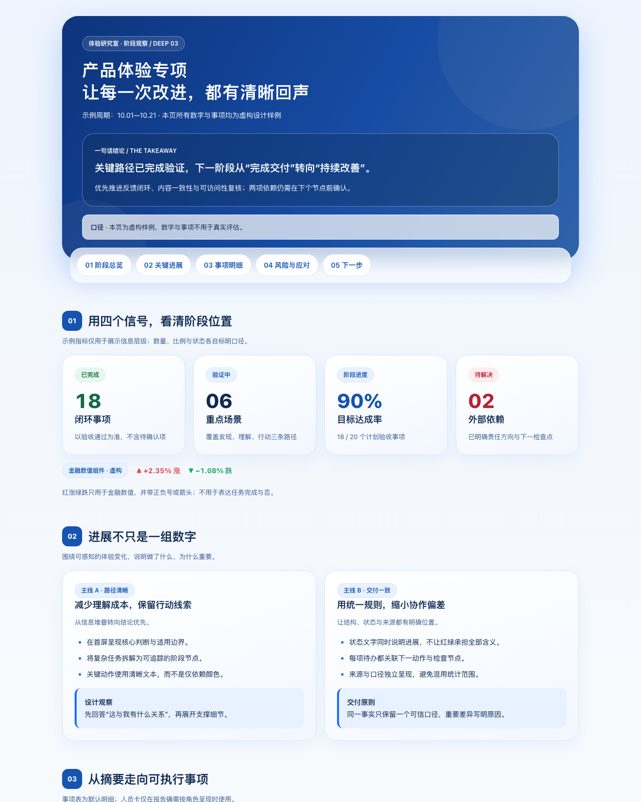
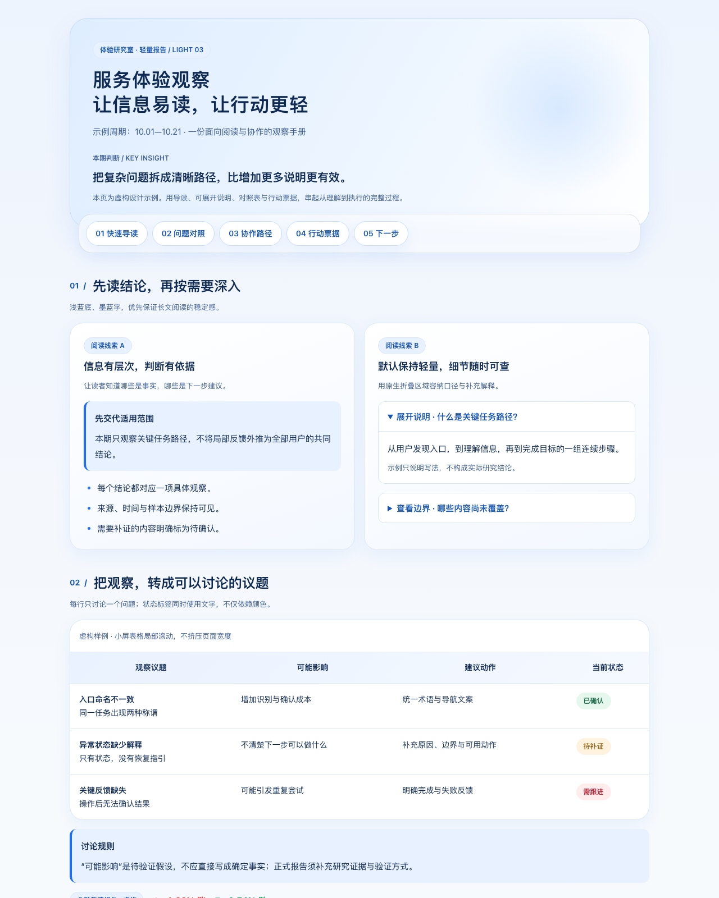

# blue-white-design · 蓝白双风格报告设计

面向报告、周报、竞品分析、方案、待办清单和数据看板的设计 Skill。同一套技能内提供 `deep` 与 `light` 两套独立规范，以及零外部依赖、可离线打开的单文件 HTML 模板。

| 项 | 值 |
|---|---|
| 当前版本 | v3.2 |
| 形态 | 技能文档 + 可离线打开的单文件 HTML 模板 |
| 适用 | 周报、阶段复盘、竞品分析、方案说明、待办清单、Dashboard |
| 不适用 | 整页深色主题、营销落地页、依赖后端交互的应用界面 |

## 效果预览

### Deep 深蓝白 · 先看到结论



深蓝首屏负责定调和结论，正文回到白至浅蓝卡片。适合重点汇报、成果总览、竞品结论。

### Light 浅蓝白 · 能读下去



浅蓝首屏不抢阅读，正文用墨蓝和更舒展的行高。适合长文方案、知识阅读、行动清单。

> 两张图均为模板内**虚构示例**的渲染截图，仅展示版式与层级；生成报告时请按实际内容替换槽位，不要照搬示例数据。

## 这是什么

一份既可以直接交给 AI 执行、也可以人工照做的排版规范。它解决的不是「蓝色好不好看」，而是：

- 同一份报告在不同人手里，间距、字阶、状态、对比度是否一致；
- 深色首屏上的白字是否真的可读，而不是看起来差不多；
- 空数据、加载中、失败这些真实场景有没有标准写法；
- 交付物能不能离线打开、不依赖外部字体与脚本。

规范之外给两套模板，复制即可用，改内容不碰样式。

## 选择风格

| 风格 | 适用内容 | 规范 | 模板 |
|---|---|---|---|
| **Deep 深蓝白** | 重点汇报、成果展示、竞品结论、需要更强视觉层级的短报告 | [深蓝白规范](references/deep-blue-white.md) | [HTML 模板](assets/blue-white-report-template.html) |
| **Light 浅蓝白** | 长文方案、知识阅读、流程和待办说明 | [浅蓝白规范](references/light-blue-white.md) | [HTML 模板](assets/blue-white-light-report-template.html) |

只说「蓝白」且无其他线索时默认选择 Deep，并在开头说明选型；明确要求长文阅读时选择 Light。两套规范各自定义首屏、文字、收尾和玻璃效果，**禁止混搭**。

| 维度 | 深蓝白 `deep` | 浅蓝白 `light` |
|---|---|---|
| 首屏 | 深蓝渐变 + 反白文字 + 受保护结论卡 | 浅蓝渐变 + 墨蓝文字 + 直接排版 |
| 正文 | 白至浅蓝卡片，紧凑（14/24） | 白至浅蓝卡片，舒展（15/28） |
| 收尾 | 深蓝渐变 + 反白节点卡 | 浅蓝至白渐变 + 墨蓝总结 |
| 玻璃层 | 最多 3 个模糊层 | 仅 1 条跨首屏导航 |
| 页面标记 | `data-blue-white-style="deep"` | `data-blue-white-style="light"` |

浅蓝首屏配白字、浅色报告夹深蓝收尾、把 deep 的深底玻璃卡搬到 light，都会破坏两套各自的辨识度。

## 快速开始

1. **选套装**：要强调结论选 `deep`；要长文阅读选 `light`。
2. **安装到技能目录**：把仓库放进所用客户端的技能目录，目录名保持 `blue-white-design`，让工具读取 `SKILL.md`。例如：

   ```bash
   # Codex
   git clone https://github.com/kittstatham/blue-white-design.git ~/.codex/skills/blue-white-design

   # Claude Code
   git clone https://github.com/kittstatham/blue-white-design.git ~/.claude/skills/blue-white-design

   # WorkBuddy
   git clone https://github.com/kittstatham/blue-white-design.git ~/.workbuddy/skills/blue-white-design
   ```

   已有安装目录时，在仓库目录运行 `git pull` 获取更新。
3. **复制模板**：把对应模板另存为交付文件，保留 `data-blue-white-style` 标记，按 `data-slot` 替换内容，完成后可移除 `data-slot`。
4. **本地预览**：直接双击模板文件即可打开，无需服务器、无需联网。

安装后可直接提出「按深蓝白规范生成汇报 HTML」或「按浅蓝白模板制作长文方案」等需求。Agent 会读取对应规范、复制对应模板，并将内容写入一份独立 HTML。生成时应按实际内容选择章节，不补造数据或任务。

## 调用句

> **深蓝白**：按 blue-white-design 的 deep 套装生成；首尾深蓝渐变与受保护的反白文字，中间白浮卡片，按共享 token 收敛排版。

> **浅蓝白**：按 blue-white-design 的 light 套装生成；浅蓝首屏、墨蓝正文、白至浅蓝卡片、浅蓝收尾，保留跨首屏的玻璃导航条，严禁套入深色首尾和白字玻璃卡。

> **玻璃增强**：按 deep 套装生成，并按 v3.2 在收尾节点容器与跨首屏的浮动导航条使用玻璃层（共 3 个模糊层）；结论主块仍反白，正文、表格与按钮不玻璃化。

## 目录结构

```
blue-white-design/
├── SKILL.md                                  # 技能入口：选型、工作流、硬规则、自检
├── README.md
├── CHANGELOG.md                              # 版本记录
├── LICENSE                                   # MIT 许可
├── .gitignore
├── references/
│   ├── design-spec.md                        # 完整规范（唯一内容源）
│   ├── deep-blue-white.md                    # 深蓝白轻量执行规范
│   └── light-blue-white.md                   # 浅蓝白轻量执行规范
└── assets/
    ├── blue-white-report-template.html       # deep 模板（含虚构示例内容）
    ├── blue-white-light-report-template.html # light 模板（含虚构示例内容）
    ├── preview-deep.png                      # deep 渲染预览
    └── preview-light.png                     # light 渲染预览
```

维护顺序固定：**先改 `references/design-spec.md`，再同步两份执行页与两份模板**，确保 SKILL、规范、执行页与模板共 6 项资料保持一致，避免规范与模板漂移。

## 设计基线

### 间距与形状

- 间距唯一梯度：`4 / 8 / 12 / 16 / 24 / 32 / 40 / 48 / 56 / 64px`
- 圆角三档：`12px` 小件、`24px` 卡片、`32px` 首屏；胶囊 `999px`、正圆 `50%` 是形状例外
- 阴影每套三档：`s / m / l`，只用蓝色投影，不用灰影
- 容器 `max-width: 1080px`；断点 `760px`，另设 `1024px` 中间态（只调布局不改字号）

### 颜色

| 角色 | 值 | 用途 |
|---|---|---|
| 正文 | `#0f2a52` | 标题、正文，替代纯黑 |
| 辅助 | `#3b5b8f` | 日期、来源、说明 |
| 链接 | `#1554b0` | 链接、按钮、蓝标签文字 |
| 强调 | `#1d6ef5` | 强调线、图形、装饰 |
| 按下（按钮） | `#082247` deep / `#c6dcfa` light | 必须比悬停更深 |
| 按下（锚点、折叠） | `#c6dcfa` | 两套通用 |
| 成功 / 警示 / 风险 | `#146a45` / `#895b11` / `#b42335` | 均配对应浅底 |

组件只引用语义变量，不把色值写进组件。金融数值单独用 `.finance` 组件实现**红涨绿跌**，且必须同时写出正负号或箭头——涨跌色不用于表达任务完成与否。

### 字阶

字号、行高、字重成组定义，组件通过 `--type-*` 引用，不散写 `font-size` + `line-height`。首屏标题用 `clamp(26px, 3.15vw, 34px)/1.29`，两端落在字阶表内，中间宽度连续插值。

### 无障碍底线

| 项 | 要求 |
|---|---|
| 正文与标签对比度 | ≥ 4.5:1 |
| 大字对比度 | ≥ 3:1 |
| 控件必要轮廓 | ≥ 3:1 |
| 可点区域 | ≥ 44 × 44px |
| 焦点 | `:focus-visible` 可见外框，深色区用浅色 |
| 状态传达 | 不只靠颜色，必须配文字 |
| 六态 | 默认 / 悬停 / 按下 / 禁用 / 加载 / 错误；锚点与折叠只需前四态 |

空态要写清「暂无内容」与「无登记 ≠ 无产出」，**0 与未知分开表达**。加载态用 `aria-disabled` + `aria-busy` 保持可聚焦，不用原生 `disabled`，否则按钮会退出 Tab 序列。

## 玻璃层规则

玻璃感来自背后的画面，不是把面板调透明。

- 只放在**有渐变、光晕或色块交界**的短信息层；纯白底不加玻璃
- 先做出能看清的半透明白底，再模糊**背后**内容；文字留在清晰层
- 玻璃内文字一律用正文墨蓝；辅助色在 `.72` 白底上仅约 3.97:1，不达标，禁用
- `backdrop-filter` 与 `-webkit-backdrop-filter` 成对书写，**不能用 `filter: blur()` 替代**——那会把面板文字一起糊掉
- 透明度只写在 `background` 的 alpha 上，不给面板整体加 `opacity < 1`
- 层数上限：`deep` 3 个模糊层，`light` 1 个；并列卡片共用一个玻璃容器，内卡不透明
- 打印、减少动效、不支持模糊、强制色彩模式下都要回退：关模糊、改实底、保留文字对比

**玻璃禁区**：结论主块、长段落、表格、折叠区、按钮六态、语义标签。

## 交付前自检

- 生成时按实际内容选择章节，不补造数据或任务；完成情况以实际渲染和交互检查为准
- 选型标记与首屏、字色、结论、收尾是否属于同一套
- 字阶是否成组引用；间距、圆角、阴影是否在梯度内；有没有未使用的 token
- 浅底标签、深底最亮区、玻璃合成底的实际对比度是否达标（按合成色测，不测原色）
- 玻璃是否只在允许位置、层数是否超限、内部文字是否全为墨蓝
- 按钮、锚点、折叠是否都有悬停与按下反馈，且按下更深
- 空态、`aria-live`、减少动效下的加载文字是否齐全
- 360 / 390px 与 1024px 下长标题、长表格是否挤出整页
- 交付文件能否离线打开，是否残留未替换的槽位

> 静态检查通过不等于视觉验收通过。模糊降级、打印、真实设备与键盘流程仍需实际看一遍。

## 版本

当前 v3.2，变更摘要见 [CHANGELOG.md](CHANGELOG.md)。

## 授权

本项目采用 [MIT License](LICENSE)：可自由使用、修改、分发，包括商业用途，保留版权声明与许可文本即可。

设计与商标边界：模板中的版式、配色与组件为原创整理，不包含任何第三方产品的界面元素、图标或商标素材；如需引入外部设计资产，请先确认其许可与商标使用范围。
